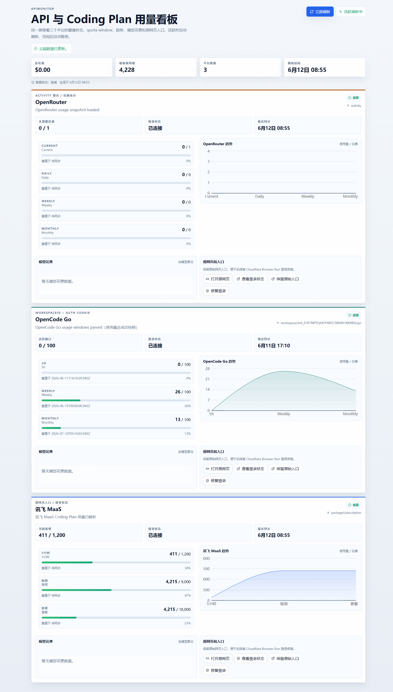
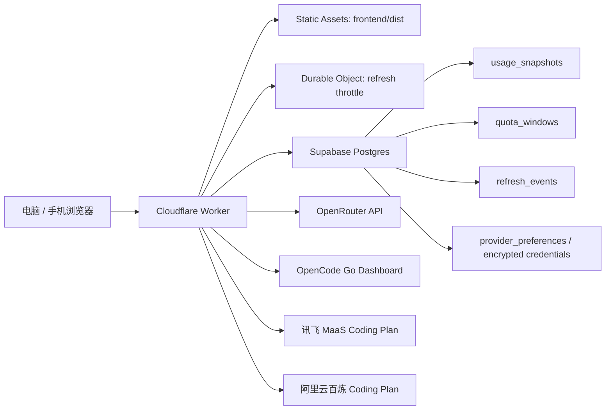
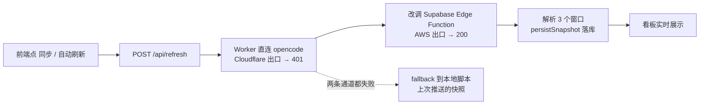

# ApiMonitor

[](LICENSE)

API 与 Coding Plan 用量聚合看板。它把 OpenRouter、OpenCode Go、讯飞 MaaS Coding Plan、阿里云百炼 Coding Plan、火山方舟 Coding Plan、智谱 BigModel Coding Plan、Ollama Pro、DeepSeek 平台、ChatGPT（Codex / 对话额度 / 订阅状态）的用量状态聚合到一个响应式网页里，并用 Supabase 保存刷新快照和云端配置。

线上示例：

https://apimonitor.bondtoolbox.asia

自定义域名（国内可直连，不受 *.workers.dev SNI 阻断影响）：

https://apimonitor.bondtoolbox.asia



## 功能亮点

- 统一展示 OpenRouter、OpenCode Go、Command Code、讯飞 MaaS、阿里云百炼、火山方舟、智谱 BigModel、Ollama Pro、DeepSeek、ChatGPT 十个平台状态。
- 支持 5 小时、每周、套餐总量等不同 quota window。
- 独立配置页支持"供应商 → 多账号 → 账号配置"的单页多层工作台。
- 首页保持一个供应商一个大卡片；多账号通过卡片内账号子卡片切换显示。
- 供应商卡片可整体停用/启用（未配置账号的供应商也能隐藏），账号可单独控制是否在首页显示，停用都不会删除配置或凭据。
- 前端活跃时最多每 2 分钟刷新一次；10 分钟无交互后停止自动刷新，避免 cron 高频轮询。
- Cloudflare Durable Object 做刷新节流。
- Supabase Postgres 保存用量快照、窗口数据和刷新事件。
- Supabase 保存配置，Worker 使用 AES-GCM 加密第三方凭据。
- OpenCode Go 支持双账号，分别登录在 Edge 不同 Profile，本地脚本串行刷新推送。
- OpenCode Go 与 ChatGPT 支持"最近成功快照"回退，降低云端抓取不稳定时的页面空窗。
- ChatGPT 因 chatgpt.com 整体拒绝 Cloudflare 出口，改由本机脚本抓取并推送快照（卡片标注"本机推送"与推送时间）。

## 当前状态

| 模块 | 状态 |
| --- | --- |
| 前端看板 | 已部署到 Cloudflare Workers Static Assets |
| Worker API | 已部署到 Cloudflare Workers |
| Supabase 存储 | 已配置表、RLS、迁移 |
| OpenRouter | 已接入 |
| OpenCode Go | 已接入，含最近成功快照回退 |
| Command Code | 已接入 `api.commandcode.ai` 三个内部接口（5h/周/月额度 + Top5 模型 + 总 token/请求），云端直连可用 |
| 讯飞 MaaS | 已接入 `coding-plan/list` 用量接口 |
| 阿里云百炼 | 已接入原网页入口；云端抓取保留为实验选项 |
| 火山方舟 | 已接入 `GetCodingPlanUsage` 用量接口（5小时/周/月百分比） |
| 智谱 BigModel | 已接入 `monitor/usage/quota/limit` + `credit-usage/usage-detail` 用量接口（5小时/周配额、Cache 命中率、积分） |
| Ollama Pro | 已接入网页登录态抓取 `settings` 页（5小时/周额度百分比、重置时间、模型请求数、预计总请求）；API Key 保留为兜底 |
| DeepSeek | 已接入余额与近 30 天用量（请求数 / Tokens / 消费、按模型聚合） |
| ChatGPT | 已接入 Codex 额度窗口与订阅档位；因 chatgpt.com 拒绝 Cloudflare 出口，数据由本机脚本 `refresh-chatgpt-usage.ts` 推送（卡片标注"本机推送"） |
| 配置页 | 已接入 `#/settings` |

## 架构



## OpenCode Go 用量抓取机制

opencode.ai 会直接拒绝 Cloudflare 出口的请求（401），Worker 直连拿不到数据。为此加了 **Supabase Edge Function 兜底通道**：Worker 直连失败时改调部署在 Supabase（Deno Deploy / AWS 东京）的函数，由它带同一份 session cookie 取数——实测 Supabase 出口没有被 opencode 封，稳定返回 200。

### 数据通路



- Edge Function 端点：`https://<project-ref>.supabase.co/functions/v1/opencode-usage`（Worker secret `OPENCODE_GO_EDGE_PROXY_URL`）
- 鉴权：请求头 `x-proxy-key` 对应 Worker secret `OPENCODE_PROXY_KEY`，函数校验通过后才转发
- 函数配置：Supabase secrets 里的 `OPENCODE_GO_WORKSPACE_ID` + `OPENCODE_GO_SESSION_COOKIE`
- 源码：`supabase/functions/opencode-usage/index.ts`

### 供应商对比

| 供应商 | 数据来源 | 点同步 | 刷新方式 |
| --- | --- | --- | --- |
| 讯飞 MaaS / OpenRouter | Worker 云端直抓 | ✅ 实时刷新 | 前端点同步 |
| OpenCode Go | 云端：Worker 直连失败 → Supabase Edge Function | ✅ 实时刷新 | 无需手动；cookie 过期时跑 `refresh-opencode-cookie.ts` |
| Command Code | Worker 云端直连 `api.commandcode.ai` | ✅ 实时刷新 | 无需手动；cookie 过期时跑 `refresh-commandcode-usage.ts` |
| 智谱 BigModel | Worker 云端直抓（持久化 cookie/token） | ✅ 实时刷新 | 本地脚本刷新 cookie 后点同步 |
| Ollama Pro | Worker 云端直抓（网页登录态 cookie） | ✅ 实时刷新 | 本地脚本刷新 cookie 后点同步 |
| DeepSeek | Worker 云端直抓（登录态有效时） | ✅ 云端直抓 | 登录态过期时跑 `refresh-deepseek-usage.ts` |
| ChatGPT | 本地脚本抓取 + 推送 | ❌ 无效（chatgpt.com 拒绝 Cloudflare 出口） | 手动跑 `refresh-chatgpt-usage.ts` |

### 注意事项

- **现在点同步是有效的**：Worker 直连 opencode 被 401 后会自动切 Supabase Edge Function，返回实时数据（快照 `meta.fetchMethod="edge_function"`）。早期「点同步无效、只能本地推」的结论已随该通道上线而改变。
- **cookie 过期后只影响取数**：Edge Function 与本地脚本依赖同一份 `__Host-console_session`（实测约 30 天）。过期后看板显示 `login_required`，跑一次 `node --experimental-strip-types scripts/refresh-opencode-cookie.ts` 会同时更新 `.env`、Worker secret、Supabase Edge Function secrets，无需改代码。
- **本地脚本保留为兜底**：`refresh-opencode-usage.ts` 在 Edge Function 也不可用时可手动推送快照，平时不需要跑。

### 刷新 Cookie 与用量（本地脚本）

部分供应商的登录态 cookie 会过期，或其用量页屏蔽数据中心 IP，需要本地脚本辅助刷新。火山/OpenCode 脚本复用本地浏览器 Profile 提取登录态，运行前需关闭对应浏览器（含后台进程）避免 Profile 锁定；Ollama 与 Command Code 脚本使用项目专用 Profile（登录一次后长期复用，不占用日常浏览器）；DeepSeek/智谱脚本用账号密码在临时浏览器登录。`.env` 中需配置 `CLOUDFLARE_API_TOKEN`。

### Command Code

Command Code（commandcode.ai）用三个内部接口取数，全部挂在 `api.commandcode.ai`：

| 接口 | 用途 |
| --- | --- |
| `/internal/usage/summary` | 总 Token / 总请求 / 总花费 / 计费周期（periodStart） |
| `/internal/usage/by-model` | 按模型聚合（取 Top5，算 token 占比） |
| `/internal/billing/credits` | 5 小时 / 每周额度窗口（used / cap / resetAt）与月度积分 |

- 鉴权只用 `__Secure-commandcode_prod_.session_token`（实测约 7 天有效），Worker 直连可用，无需 Edge Function。
- 本地脚本 `refresh-commandcode-usage.ts` 用专用 Profile（`output/commandcode-profile/`）提取 cookie 并推送；首次运行会打开窗口让你登录一次。
- cookie 过期后跑一次该脚本即可，会同时更新 `.env`、Worker secret、Supabase 加密凭据与 Edge Function secrets。
- 官方文档参考：<https://commandcode.ai/jarvislee90s-dot/settings/usage>

#### 一键刷新：`refresh-enabled.bat`（推荐日常使用）

双击项目根目录的 `refresh-enabled.bat`：先请求线上 `/api/usage` 拿**看板实际显示的供应商**（请求失败时回退 Supabase 设置推导），再**依次刷新处于显示状态的那些**，跳过停用或未设首页显示的供应商并给出原因。

```powershell
.\refresh-enabled.bat            # 列状态 + 依次刷新显示中的供应商
.\refresh-enabled.bat --list     # 只看状态，不刷新
```

只刷 ChatGPT 的话，双击根目录的 **`refresh-chatgpt.bat`**：读 Codex 本地会话日志推送额度，**免代理、免浏览器、免验证码，通常 2 秒**内完成（适合每次用完 Codex 后点一下，让看板与 CLI「剩余用量」保持一致）。

各供应商的刷新动作：

| 供应商 | 刷新动作 | 说明 |
| --- | --- | --- |
| 智谱 BigModel | `refresh-zhipu-cookie.ts` | 账号密码登录刷新 cookie（可能需人工过验证码） |
| Ollama Pro | `refresh-ollama-cookie.ts` | 专用 Profile 复用登录态，失效时弹浏览器登录 |
| ChatGPT (Codex) | `refresh-chatgpt-usage.ts --local` | 读 Codex 本地会话日志，免代理、免浏览器、秒级 |
| OpenCode Go | `refresh-opencode-usage.ts` | 需先关闭 Edge；双账号串行抓取后推送 |
| Command Code | `refresh-commandcode-usage.ts` | 专用 Profile 提 cookie；缓存有效时不开浏览器 |

注意：

- 某供应商显示「不显示」时会被跳过。例如 OpenCode Go 若两个账号都没设首页显示，看板上就不会出现它的卡片，脚本也不会刷新它——需要的账号去设置页（`#/settings`）打开首页显示即可。
- ChatGPT 用的是 `--local`（与 CLI「剩余用量」同源）；要同时刷新订阅档位与续费日期（需要代理与网页会话），单独跑一次 `node --experimental-strip-types scripts/refresh-chatgpt-usage.ts`。
- 看板上的 ChatGPT 额度**只能与「最后一次推送」一样新**：云端取不到 chatgpt.com 数据，所以没有本地推送就不会更新（卡片「推送时间」即该快照的采集时间）。想让它自动保持最新，可把 `refresh-chatgpt.bat`（或 `refresh-chatgpt-usage.ts --local`）挂到 Windows 任务计划程序，例如每 10 分钟一次。
- 刷新失败的项不影响看板：会继续显示最近一次成功快照。

#### 智谱 BigModel Cookie 刷新

智谱登录态 token 约 7 天过期，过期后看板会显示 `login_required`。用账号密码登录并刷新 cookie：

```powershell
node --experimental-strip-types scripts/refresh-zhipu-cookie.ts
```

脚本读取 `.env` 中的 `Zai_account` / `Zai_password` 打开可见浏览器登录 `open.bigmodel.cn`，提取 `bigmodel_token_production` 与 `acw_tc` / `ssxmod_itna` 等 WAF cookie，调 `/monitor/usage/quota/limit` 验证后，写入 Supabase（provider_key=`zhipu`、label=`默认账号`，AES-GCM 加密 `{authCookie, authToken}`），并同步更新本地 `.env` 的 `ZHIPU_AUTH_COOKIE` / `ZHIPU_AUTH_TOKEN` 与 Cloudflare Worker 的 `ZHIPU_AUTH_COOKIE` secret。若遇腾讯点选验证码（点击图中文字，非滑块），脚本会提示并在浏览器中等待人工完成（最长 180 秒），不自动绕过。

#### 火山方舟 Cookie 刷新

火山方舟登录态 cookie 过期后，看板会显示 `login_required`。运行：

```powershell
node --experimental-strip-types scripts/refresh-volc-ark-cookie.ts
```

脚本从浏览器提取 `csrfToken` / `digest` / `AccountID` / `userInfo` 四个 cookie，调 `GetCodingPlanUsage` 验证有效性后，同时更新本地 `.env` 的 `VOLC_ARK_AUTH_COOKIE` 和 Cloudflare Worker 的同名 secret。若本地浏览器 Profile 被占用，会自动回退到临时浏览器——在弹出窗口登录火山方舟即可，脚本自动继续。

#### OpenCode Go 本地兜底刷新（通常不需要）

看板日常刷新走云端（Worker 直连失败会自动切 Supabase Edge Function），**不需要跑本地脚本**。只有云端两条通道都失败时，才用本地脚本手动推送快照：

```powershell
node --experimental-strip-types scripts/refresh-opencode-usage.ts
```

脚本从 .env 读取两个账号的 workspaceId（`OPENCODE_GO_WORKSPACE_ID` 和 `OPENCODE_GO_WORKSPACE2_ID`）与缓存的 session cookie，逐个调 `GET https://opencode.ai/console/api/go/status`（带 `x-org-id` 头），解析 5h / Weekly / Monthly 后推送到 `/api/ingest/opencode-go`。

- **cookie 优先**：`.env` 里已有有效 `OPENCODE_GO_SESSION_COOKIE` 时不会启动浏览器，通常几秒完成。
- **cookie 失效才开浏览器**：打开对应 Edge Profile 的 `/console/<workspaceId>/go`，保留窗口等你登录（最长 300 秒），成功后自动写回 `.env`。
- 账号2 `lijiawei_jarvis` 标记为可选账号，停用时跳过，不阻塞账号1。
- 无人值守场景（`refresh-enabled.bat`）会传 `--no-wait-login`，登录失效直接跳过该账号。

> **注意**：Chrome 149+ 的 App-Bound Encryption (ABE) 会阻止 CDP 读取 cookie，两个账号都必须用 Edge 浏览器登录。

#### OpenCode Go Cookie 刷新（cookie 过期时跑这个）

Edge Function 与本地脚本共用同一份 `__Host-console_session`（实测约 30 天）。过期后看板显示 `login_required`，运行：

```powershell
node --experimental-strip-types scripts/refresh-opencode-cookie.ts
```

脚本从浏览器 Profile 提取 `__Host-console_session`，用 `GET /console/api/go/status`（带 `x-org-id`）验证，然后**一次性同步三处**：

1. 本地 `.env` 的 `OPENCODE_GO_SESSION_COOKIE`
2. Cloudflare Worker secret `OPENCODE_GO_SESSION_COOKIE`
3. Supabase Edge Function secrets（`OPENCODE_GO_SESSION_COOKIE` / `OPENCODE_GO_WORKSPACE_ID`）

跑完刷新看板即恢复，无需改代码或重新部署。

#### Ollama Pro Cookie 刷新

**为什么 Ollama 需要 cookie 而不是 API Key**：Ollama 官方 `/api/usage` 接口（API Key 通道）已改为只返回请求数统计，**不再提供 5小时/周额度百分比与模型请求明细**；这些数据只出现在网页登录态（`ollama.com/settings`）的服务端渲染 HTML 里。因此看板抓取优先走 cookie，API Key 仅作为兜底。

登录态过期后看板会显示 `login_required` 或额度数据为空，运行：

```powershell
node --experimental-strip-types scripts/refresh-ollama-cookie.ts
```

脚本使用**项目专用浏览器 Profile**（`output/ollama-browser-profile/`，已被 gitignore，不会提交）：

- 首次运行或登录态失效时，会打开浏览器窗口等待人工登录 ollama（GitHub / 邮箱均可，最长等待 300 秒）；**登录一次后 cookie 持久化在专用 Profile 中，以后重跑直接复用、无需再登**。
- 提取 `__Secure-session` 等 ollama.com cookie 后，调 `settings` 页验证（能解析出额度百分比才算有效），再写入 Supabase（provider_key=`ollama`、label=`默认账号`，AES-GCM 加密 `{authCookie}`）、本地 `.env` 的 `OLLAMA_AUTH_COOKIE` 与 Cloudflare Worker 的同名 secret。

强制换账号重新登录（会先清除旧 cookie）：

```powershell
node --experimental-strip-types scripts/refresh-ollama-cookie.ts --relogin
```

Worker 端的抓取逻辑（`worker/providers/ollama.ts`）：优先用 `authCookie` 请求 `ollama.com/settings` 并解析 HTML 中的额度百分比、重置时间（`data-time`，页面权威值）与模型请求列表；cookie 不可用时自动回退 API Key 通道并在摘要中提示需要刷新登录态。

#### DeepSeek 用量刷新

DeepSeek 用账号密码登录平台后抓取余额与近 30 天用量（请求数 / Tokens / 消费 / 按模型聚合），推送快照并把新 token / WAF cookie 写回 `.env` 供云端直抓使用：

```powershell
node --experimental-strip-types scripts/refresh-deepseek-usage.ts
```

脚本读取 `.env` 中的 `DEEPSEEK_USER` / `DEEPSEEK_PASS`，打开可见浏览器登录 `platform.deepseek.com`（若出现滑块验证码需人工完成），推送到 `/api/ingest/deepseek`，并刷新 `.env` 的 `DEEPSEEK_USER_TOKEN` / `DEEPSEEK_AUTH_COOKIE`。

#### ChatGPT 用量刷新（本机推送）

**为什么 ChatGPT 必须走本机推送**：2026-10-14 实测确认，`chatgpt.com` 对 Cloudflare 出口**整体 403 拒绝**——不只是用量接口，连 `robots.txt` 都是 403，且响应里没有 `cf-mitigated` 头（是 CF 的拦截页而非质询）；换 UA、加 `originator: codex_cli_rs`、浏览器风格请求头都无效。Cloudflare Browser Rendering（浏览器农场出口）经生产实测同样被拒（页面内同源 fetch 也是 403）。因此**云端两条路都不可能取到 ChatGPT 数据**，唯一可行的是本机浏览器会话（住宅 IP + 真实指纹 + cf_clearance）。

```powershell
node --experimental-strip-types scripts/refresh-chatgpt-usage.ts
```

脚本做三件事，全部在打开的浏览器页面内同源执行（借用项目专用 Profile `output/chatgpt-browser-profile/`，已 gitignore）：

1. 取 Codex 链路：用凭据里的 accessToken 抓 `backend-api/codex/usage`（Codex 额度窗口 + 顶层 `plan_type` 订阅档位）。该请求**不带** session cookie（cookie 与 Bearer 同时出现会被服务端判 `token_expired`）；
2. 用 Profile 登录态抓 `backend-api/rate_limits`（网页对话额度）与 `backend-api/accounts/check/v4-2023-04-27`（订阅档位与续费日期）。这两个请求必须 **cookie + session Bearer 一起带**：实测只有 cookie-only 会退化成访客视图（`plan_type=guest`、`renews_at=null`），只有 Bearer 则直接 403；
3. 把**原始 payload** POST 到 `/api/ingest/chatgpt`（`X-Ingest-Key` 鉴权），由 Worker 侧复用同一套解析器组装快照落库，脚本与云端不会出现两份解析逻辑。

凭据来源与刷新（脚本不再依赖本地 CLI token）：

1. `CHATGPT_ACCESS_TOKEN` 环境变量（临时覆盖）；
2. **Supabase 存储副本**（worker 用的同一份加密凭据）：token 失效时脚本会用它自带的 `refreshToken` 刷新，并**写回 Supabase**，所以看板链路不会因为本地 `~/.codex/auth.json` 过期而断；
3. 本地 `~/.codex/auth.json`（兜底）。

实测结论（2026-10-15，Plus 档验证）：订阅档位变化后，旧 token 即使未到 `exp` 也会被服务端判为 `token_expired`，因此脚本内置了「401/403 → 刷新 → 重试一次」；刷新走 `auth.openai.com/oauth/token`（本机代理出口可用）。本地 `auth.json` 的 ChatGPT token 若已失效，需要时在 Codex CLI 里重新登录（`codex login`），但这不影响看板数据。

看板表现：ChatGPT 卡按**两个独立额度桶**分开展示——「Codex 编码额度」（Codex CLI/IDE 的 5 小时 / 每周 / 30 天窗口）与「网页对话额度」（网页聊天的 5 小时模型组窗口），两桶独立计量，Codex 用尽不影响网页聊天。网页桶暂无数据时卡片会显示占位说明行（该接口对免费与 Plus 会话实测均为 404，属 OpenAI 未对外提供）。「抓取方式」显示**本机推送**，并附带「推送时间」（数据新鲜度）；卡片数据来自最近一次成功推送（云端刷新失败时回退到该快照，摘要会注明"使用最近成功快照"）。

**更快的一条路：`--local`（推荐日常使用）**

Codex CLI/IDE 每次请求都会把服务端返回的额度写进本地会话日志（`~/.codex/sessions/<年>/<月>/<日>/rollout-*.jsonl` 的 `payload.rate_limits`），这正是 CLI「剩余用量」面板显示的数据。本地模式直接读它，**免浏览器、免代理、秒级完成**：

```powershell
node --experimental-strip-types scripts/refresh-chatgpt-usage.ts --local
```

- 额度窗口（5 小时 / 每周）与档位取自日志，采集时间也用日志时间（卡片「推送时间」即 Codex 观测到该额度的时间）；
- 订阅档位与续费时间沿用库里最近一次成功快照（免网络），因此 `--local` 不需要开代理；
- 与 CLI 面板一致：实测 `backend-api/codex/usage` 的 `used_percent` 与 CLI/日志并不相同（2026-10-15：API 报 0，CLI 报 5），所以看板对齐 CLI 时以日志为准；
- 适合挂 Windows 任务计划程序做周期同步（无窗口、无网络依赖）。

注意事项：

- `.env` 需要 `INGEST_API_KEY` 与 `APIMONITOR_INGEST_URL`（与其它 refresh 脚本共用）。
- 首次运行或登录态失效时，脚本会打开浏览器等待人工 Google 登录（最长 300 秒）；**登录一次后 cookie 持久化在专用 Profile 中，后续直接复用**。
- 云端封禁不代表登录态失效：Worker 侧已把「403 + 拦截页 + 无 `cf-mitigated`」单独归类为出口封锁，不会误报"登录态已失效"，也不会消耗 Codex token 刷新（避免 refresh token 轮换后无法写回）。
- **续费日期来自真实账号的网页会话**（已接入，卡片显示 `renews_at`，本次为 11月15日 13:15）：项目 Profile 需处于真实账号登录态。若卡片显示「订阅前无数据」，说明会话是访客/未登录，用 Plus 账号登录一次即可：

  ```powershell
  node --experimental-strip-types scripts/import-chatgpt-credentials.ts --relogin --web-only
  ```

  `--web-only` 只续期网页 session cookie（不要求本地 codex token 有效），写入时与已存凭据合并；脚本以 `/api/auth/session` 的 `user.email` + `account.planType` 判定真实账号，访客会明确报错而不是静默通过。
- **网页对话额度没有数据源（已定论）**：`rate_limits`、`usage_limits` 在免费档、访客会话与 Plus 真实会话下实测均为 404（`conversation/limit` 400），OpenAI 未对外提供该额度接口，卡片固定显示「与 Codex 独立计量」的说明行；订阅档位在网页会话不可用时会由 `codex/usage` 的 `plan_type` 兜底。
- 想确认免费档「网页对话额度」是否有其它数据源，可在本机（代理开启、Profile 已登录）跑 `node --experimental-strip-types scripts/probe-chatgpt-endpoints.ts --browser`：它会在页面内探测 `rate_limits`、`accounts/check/v4-2023-04-27`、`models`、`me`、`settings/user`、`conversation/limit`、`usage_limits` 等候选端点，输出状态码与脱敏结构。
- 想自动刷新可把该命令挂到 Windows 任务计划程序，与其它 refresh 脚本相同。

## 目录结构

```text
.
├── frontend/              # React + Vite 前端，Cloudflare 静态资源来源
│   ├── src/
│   ├── index.html
│   └── package.json
├── worker/                # Cloudflare Worker API 与 provider adapters
│   ├── providers/
│   ├── durable-object/
│   └── index.ts
├── scripts/               # 本机抓取 / 推送 / cookie 刷新脚本（Node + Playwright）
├── supabase/migrations/   # Supabase 数据库迁移
├── tests/                 # 前端 hook、Worker、真实 e2e 测试
├── docs/                  # 计划、部署说明、README 图片资源
├── wrangler.toml          # Cloudflare Worker + Static Assets 配置
└── .env.example           # 本地环境变量模板
```

## 快速开始

安装依赖：

```powershell
npm install
```

复制环境变量模板：

```powershell
Copy-Item .env.example .env
```

本地开发前端：

```powershell
npm run dev
```

常规验证：

```powershell
npm run test
npm run build
```

真实端到端验证需要 `.env` 中配置真实 Supabase、OpenRouter、OpenCode Go 和讯飞 MaaS 登录态：

```powershell
$env:RUN_REAL_E2E="1"
npx vitest run tests/e2e/real-refresh.test.ts
```

## 部署

当前推荐部署方式是 Cloudflare Worker 同时托管 API 和前端静态资源。

部署前先构建前端：

```powershell
npm run build
```

上传 Worker secrets：

```powershell
npx wrangler@4 secret put SUPABASE_URL
npx wrangler@4 secret put SUPABASE_SERVICE_ROLE_KEY
npx wrangler@4 secret put CREDENTIAL_ENCRYPTION_KEY
npx wrangler@4 secret put OPENROUTER_API_KEY
npx wrangler@4 secret put OPENCODE_GO_WORKSPACE_ID
npx wrangler@4 secret put OPENCODE_GO_SESSION_COOKIE
npx wrangler@4 secret put XFYUN_MAAS_API_URL
npx wrangler@4 secret put XFYUN_MAAS_AUTH_COOKIE
npx wrangler@4 secret put ALIYUN_BAILIAN_AUTH_COOKIE
npx wrangler@4 secret put ALIYUN_BAILIAN_SEC_TOKEN
npx wrangler@4 secret put VOLC_ARK_AUTH_COOKIE
npx wrangler@4 secret put ZHIPU_AUTH_COOKIE
npx wrangler@4 secret put OLLAMA_AUTH_COOKIE
```

部署：

```powershell
npm run deploy:worker
```

`wrangler.toml` 中的关键配置：

```toml
[assets]
directory = "./frontend/dist"
not_found_handling = "single-page-application"
# 不需要 run_worker_first：wrangler 4 默认行为是 assets 不匹配时自动 fallback 到 worker
```

## 环境变量

不要提交 `.env`。公开仓库只保留 `.env.example`。

| 变量 | 用途 |
| --- | --- |
| `SUPABASE_URL` | Supabase 项目地址 |
| `SUPABASE_SERVICE_ROLE_KEY` | Worker 写入 Supabase 使用 |
| `CREDENTIAL_ENCRYPTION_KEY` | 32 字节 AES-GCM 加密 key，用于云端账号凭据 |
| `OPENROUTER_API_KEY` | OpenRouter key endpoint |
| `OPENCODE_GO_WORKSPACE_ID` | OpenCode Go 账号1 workspace id |
| `OPENCODE_GO_WORKSPACE2_ID` | OpenCode Go 账号2 workspace id |
| `OPENCODE_GO_SESSION_COOKIE` | OpenCode Go 账号1 的 `__Host-console_session`（本地脚本自动写回） |
| `OPENCODE_GO_SESSION_COOKIE2` | OpenCode Go 账号2 的 `__Host-console_session` |
| `OPENCODE_GO_EDGE_PROXY_URL` | Supabase Edge Function 地址（云端兜底通道），如 `https://<ref>.supabase.co/functions/v1/opencode-usage` |
| `OPENCODE_PROXY_KEY` | Edge Function 与 Worker 共享的调用密钥（`x-proxy-key`） |
| `COMMANDCODE_SESSION_COOKIE` | Command Code 的 `__Secure-commandcode_prod_.session_token`（本地脚本自动写回） |
| `COMMANDCODE_ACCOUNT` | Command Code 账号 slug（默认 `jarvislee90s-dot`） |
| `COMMANDCODE_API_BASE_URL` | 可选，默认 `https://api.commandcode.ai` |
| `COMMANDCODE_EDGE_PROXY_URL` | 可选，Command Code 的 Edge Function 兜底地址 |
| `XFYUN_MAAS_API_URL` | 讯飞 `coding-plan/list` 用量接口 |
| `XFYUN_MAAS_AUTH_COOKIE` | 讯飞登录 cookie |
| `ALIYUN_BAILIAN_PAGE_URL` | 阿里云百炼 Coding Plan 看板入口 |
| `ALIYUN_BAILIAN_API_URL` | 可选，实验性云端抓取接口；默认不启用 |
| `ALIYUN_BAILIAN_AUTH_COOKIE` | 阿里云百炼登录 cookie，默认入口模式不主动使用 |
| `ALIYUN_BAILIAN_SEC_TOKEN` | 可选，实验性云端抓取需要的阿里云 token |
| `ALIYUN_BAILIAN_CLOUD_FETCH` | 可选，设为 `1` 才启用百炼云端抓取实验 |
| `VOLC_ARK_PAGE_URL` | 火山方舟 Coding Plan 订阅页入口 |
| `VOLC_ARK_API_URL` | 可选，留空则用默认 `GetCodingPlanUsage` 端点 |
| `VOLC_ARK_AUTH_COOKIE` | 火山方舟登录态 cookie（csrfToken / digest / AccountID / userInfo） |
| `ZHIPU_PAGE_URL` | 智谱 Coding Plan 用量页入口 |
| `ZHIPU_API_BASE` | 智谱用量接口前缀（默认 `https://bigmodel.cn/api`） |
| `ZHIPU_AUTH_COOKIE` | 智谱登录态 cookie（`bigmodel_token_production` + `acw_tc` 等 WAF cookie） |
| `ZHIPU_AUTH_TOKEN` | 智谱登录 token（即 `bigmodel_token_production` 的值） |
| `Zai_account` / `Zai_password` | 智谱登录脚本专用账号密码（不写入 Worker） |
| `OLLAMA_PAGE_URL` | Ollama 用量页入口（默认 `https://ollama.com/settings`） |
| `OLLAMA_URL` | Ollama API 前缀（默认 `https://ollama.com/v1`，兜底通道使用） |
| `OLLAMA_KEY` | Ollama API Key（兜底通道，仅提供请求数统计） |
| `OLLAMA_AUTH_COOKIE` | Ollama 网页登录态 cookie（额度百分比与模型请求明细的必需项） |
| `CLOUDFLARE_API_TOKEN` | 本地 Wrangler 部署使用 |
| `DEEPSEEK_USER` / `DEEPSEEK_PASS` | DeepSeek 平台登录账号密码（仅脚本使用，不写入 Worker） |
| `DEEPSEEK_USER_TOKEN` / `DEEPSEEK_AUTH_COOKIE` | DeepSeek 云端抓取登录态（脚本自动刷新并写回） |
| `INGEST_API_KEY` | 本地脚本推送快照的共享密钥（opencode / deepseek / zhipu / chatgpt 共用，Worker 端需配置同名 secret） |
| `APIMONITOR_INGEST_URL` | 本地脚本推送目标（Worker 线上地址，已配置为自定义域名） |

## 安全说明

- `.env`、cookie、service role key 不进入 Git。
- 配置页只把第三方凭据发给 Worker，Worker 加密后写入 Supabase `provider_account_credentials` 表；前端只读取脱敏 `credential_hint`。在新 schema migration 部署前的过渡期，账号级配置和凭据 JSONB 会以兼容模式存到 `provider_accounts.config`（未加密）；迁移完成后此兼容模式自动失效。
- 账号级停用只影响首页展示，不删除 Supabase 中的账号元数据和加密凭据。
- 供应商级停用（配置页供应商卡片上的「停用」）只改 `provider_preferences.enabled`，看板不再显示该卡片，同样不删除配置或凭据。
- ChatGPT 推送脚本与导入脚本使用项目专用浏览器 Profile（`output/chatgpt-browser-profile/`），只在本机复用登录态，cookie 不落盘到项目目录、不进 git；脚本运行日志只输出脱敏 hint。
- 阿里云百炼默认只保存原网页入口；实验性云端抓取字段默认不填写、不启用。
- `output/`、`.wrangler/`、`node_modules/`、`frontend/dist/` 已被忽略。
- README 截图只展示用量，不包含密钥。
- 如果浏览器 DevTools 或日志中曾显示过第三方平台返回的应用凭据，建议在对应平台重置凭据。

## 开发命令

| 命令 | 说明 |
| --- | --- |
| `npm run dev` | 启动前端开发服务 |
| `npm run test` | 跑前端和 Worker 单元测试 |
| `npm run build` | 类型检查并构建前端 |
| `npm run deploy:worker` | 构建前端并部署 Worker + 静态资源 |
| `npm run test:worker` | 只跑 Worker 测试 |
| `npm run test:frontend` | 只跑前端测试 |

## 致谢

本项目在架构和实现过程中参考了以下开源项目，致谢其作者：

- [all-api-hub](references/all-api-hub) — 账号卡片与原网页入口
- [codeburn](references/codeburn) — Provider adapter 抽象
- [onwatch](references/onwatch) — OpenRouter API 思路
- [one-api](references/one-api) — 余额与渠道健康模型
- [opencode-quota](references/opencode-quota) — OpenCode Go 用量窗口抓取思路

参考项目在 `references/` 目录下，仅供设计参考，**未将代码直接复制到正式实现**。

## 后续计划

- 模型级花费明细。
- 更稳定的 OpenCode Go 云端抓取策略。
- 把 ChatGPT cookie 续期并入 `refresh-chatgpt-usage.ts`（每次推送顺带写回新 session cookie），并按需挂任务计划自动推送。
- 手机端交互细节优化。
- 用量预测和阈值告警。
